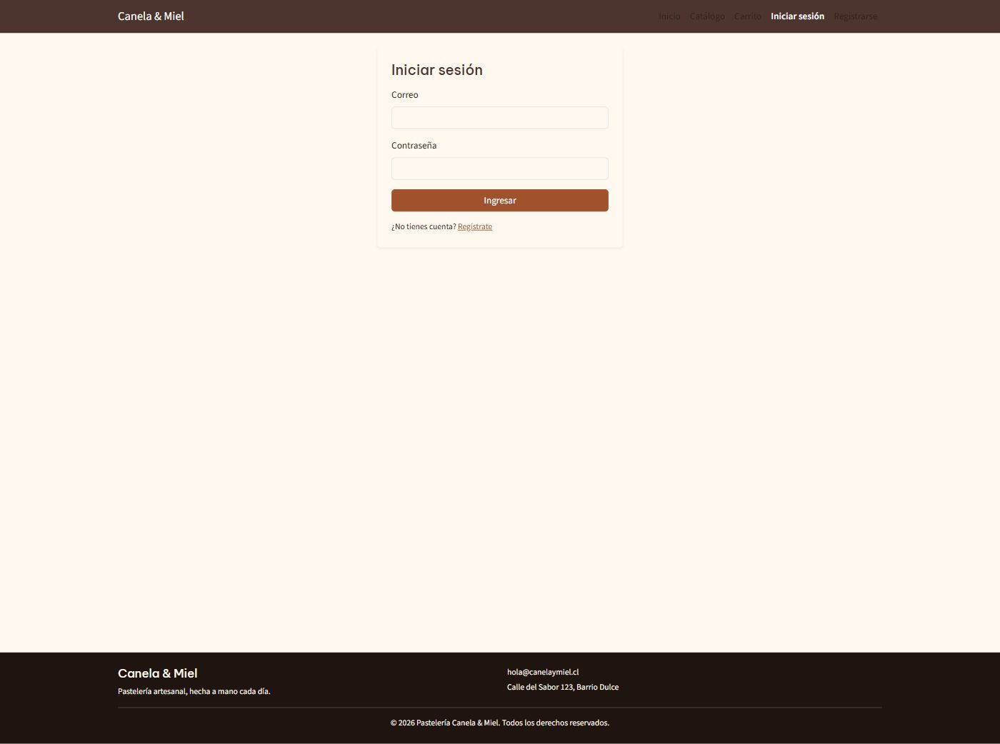
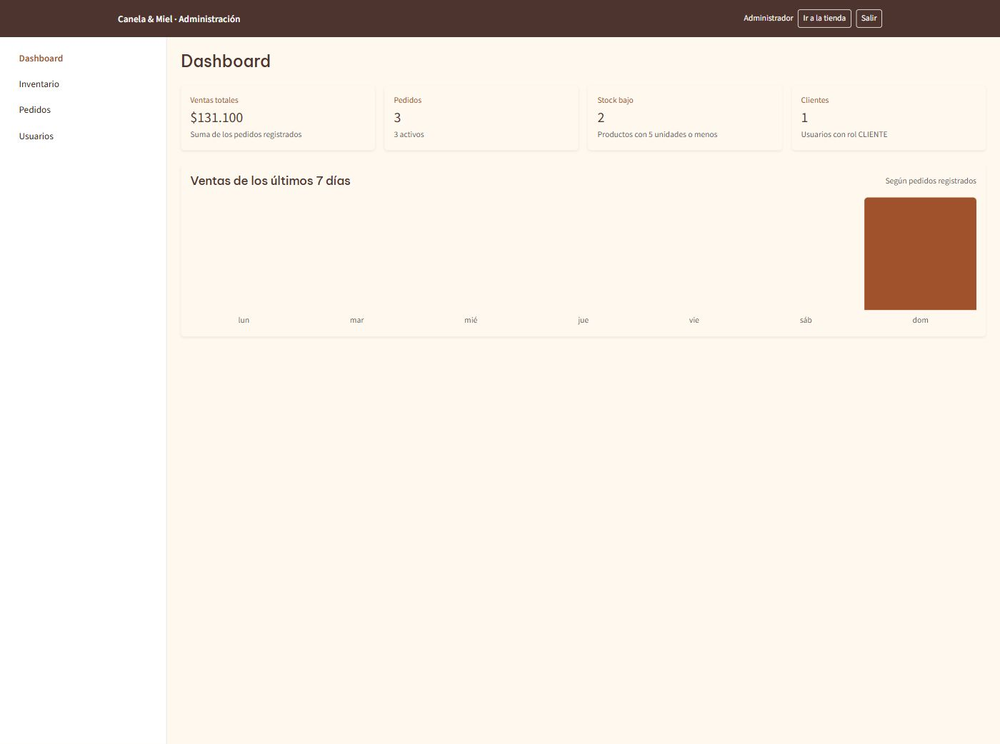
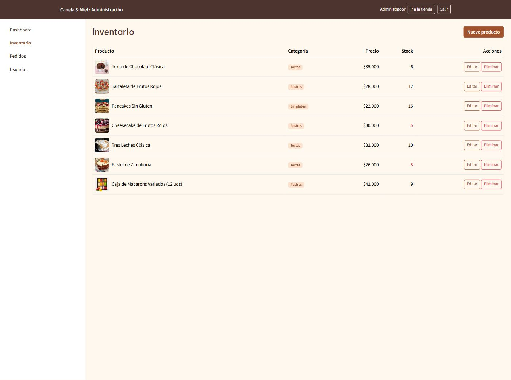
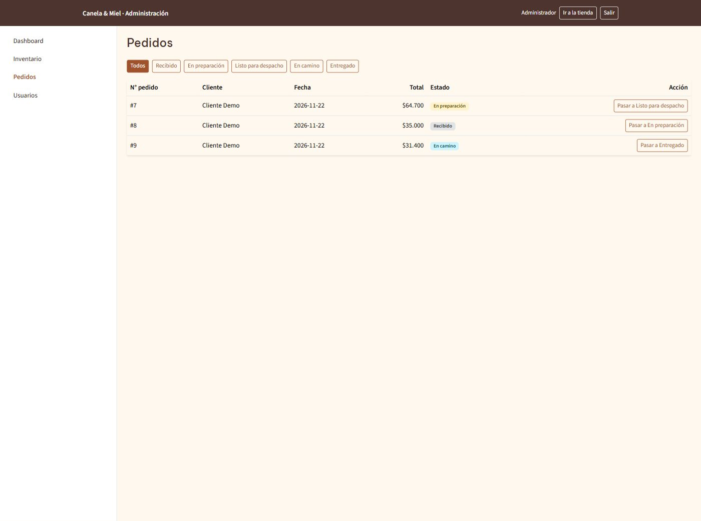
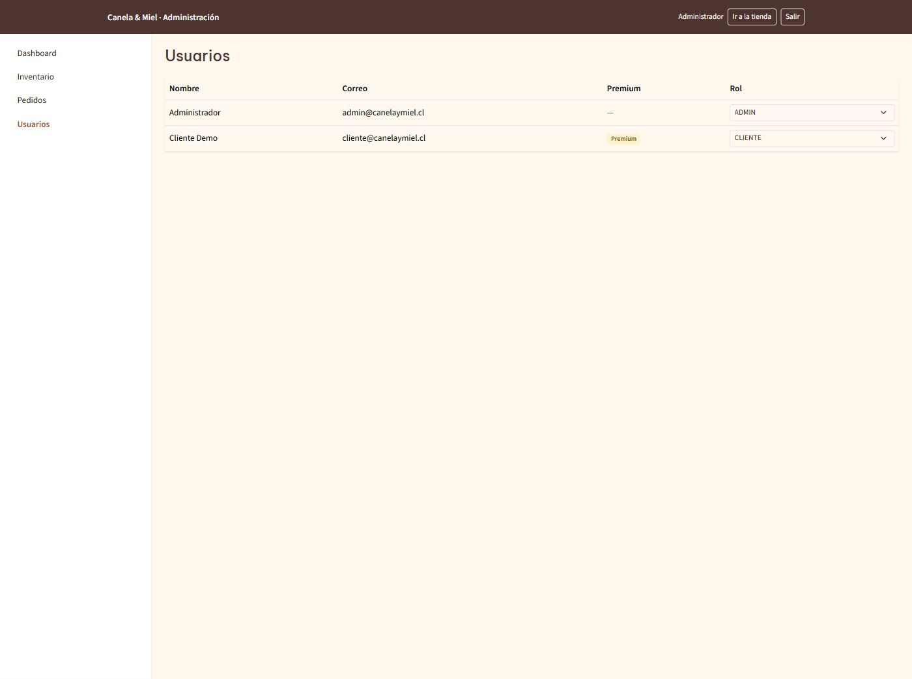
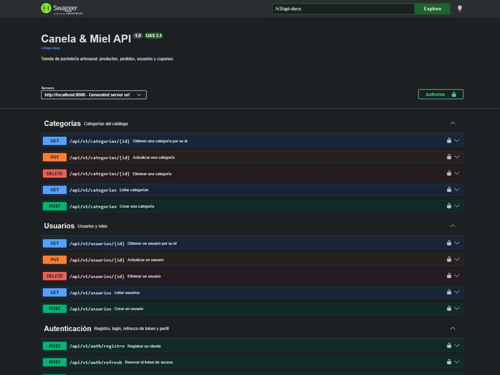

# Documentación de API e Integración — Canela & Miel

**Título:** Documentación de API e Integración del sistema Canela & Miel
**Versión del documento:** 1.0
**Fecha:** 22/11/2026
**Proyecto:** DSY1104 Desarrollo Fullstack II — Evaluaciones Parciales 2 y 3
**Equipo:** Canela & Miel

---

## 1. Descripción general

Este documento describe los endpoints REST del backend de **Canela & Miel**, la forma de autenticarse y cómo el frontend en React consume la API. Está dirigido a quien deba probar, mantener o presentar el sistema.

La aplicación permite:

- Consultar el catálogo de productos sin iniciar sesión.
- Registrarse e iniciar sesión con JWT.
- Crear pedidos con descuento Premium, cupones y descuento de stock.
- Administrar productos, categorías, pedidos, usuarios y cupones según el rol.

La estructura sigue el Anexo 2 del curso, adaptada del ejemplo "Pokémon Go" a Canela & Miel.

## 2. Información general

| Elemento | Valor |
|---|---|
| URL base de la API | `http://localhost:8080/api/v1` |
| URL de Swagger | `http://localhost:8080/swagger-ui.html` |
| Especificación OpenAPI | `http://localhost:8080/v3/api-docs` |
| Formato de datos | JSON con codificación UTF-8 |
| Autenticación | JWT enviado como `Authorization: Bearer <token>` |
| Origen permitido (CORS) | `http://localhost:5173` |
| Base de datos | MySQL 8 en Docker (`canela_miel`) |

## 3. Autenticación y roles

### 3.1 Flujo

1. El usuario se registra en `POST /auth/registro` o inicia sesión en `POST /auth/login`.
2. El backend valida la contraseña con **BCrypt** y devuelve:
   - `token`: token de acceso, dura **15 minutos** e incluye el rol.
   - `refreshToken`: token de renovación, dura **7 días**.
   - `usuario`: datos públicos del usuario.
3. El frontend guarda los tres valores en `localStorage` y envía el token de acceso en cada petición.
4. Si el backend responde **401** porque el acceso venció, el frontend llama a `POST /auth/refresh` y repite la petición una vez.
5. Si el refresh también falla, se cierra la sesión y se vuelve a `/login`.

### 3.2 Roles

| Rol | Puede |
|---|---|
| Público (sin sesión) | Ver catálogo, registrarse, iniciar sesión, ver Swagger |
| `CLIENTE` | Ver y crear **sus propios** pedidos, ver su perfil |
| `ADMIN` | Todo lo del cliente, más productos, categorías, usuarios, cupones y cambios de estado |

### 3.3 Respuesta del login

```json
{
  "token": "eyJhbGciOiJIUzI1NiJ9...",
  "refreshToken": "eyJhbGciOiJIUzI1NiJ9...",
  "usuario": {
    "id": 2,
    "nombre": "Cliente Demo",
    "correo": "cliente@canelaymiel.cl",
    "premium": true,
    "activo": true,
    "rol": "CLIENTE"
  }
}
```

### 3.4 Cómo probar con Swagger

1. Abrir `http://localhost:8080/swagger-ui.html`.
2. Ejecutar `POST /api/v1/auth/login` con un usuario de prueba.
3. Copiar el valor de `token`.
4. Pulsar **Authorize** y pegar solo el token (sin la palabra `Bearer`).
5. Los endpoints protegidos quedan habilitados con ese rol.

## 4. Convenciones de respuesta

| Código | Significado en esta API |
|---|---|
| `200` | Operación exitosa con cuerpo |
| `201` | Recurso creado |
| `204` | Eliminación exitosa, sin cuerpo |
| `400` | Datos inválidos, cupón inválido o cuerpo mal formado |
| `401` | Sin token, token vencido o credenciales incorrectas |
| `403` | El rol o el dueño del recurso no permite la acción |
| `404` | Recurso no encontrado |
| `409` | Conflicto: stock insuficiente, estado fuera de orden, código duplicado o registro con datos asociados |
| `500` | Error no controlado del servidor |

Todos los errores usan la misma estructura:

```json
{
  "fecha": "2026-11-22T12:00:00",
  "estado": 409,
  "mensaje": "Stock insuficiente para Torta de Chocolate Clásica"
}
```

## 5. Endpoints

### 5.1 Autenticación

| Método | Ruta | Descripción | Entrada | Respuestas | Acceso |
|---|---|---|---|---|---|
| POST | `/auth/registro` | Crea un usuario `CLIENTE` y devuelve tokens | `{ nombre, correo, password }` | 201, 400, 409 | Público |
| POST | `/auth/login` | Valida correo y contraseña | `{ correo, password }` | 200, 401 | Público |
| POST | `/auth/refresh` | Renueva el token de acceso | `{ refreshToken }` | 200, 401 | Público |
| GET | `/auth/perfil` | Devuelve el usuario del token | — | 200, 401 | Autenticado |

### 5.2 Productos

| Método | Ruta | Descripción | Entrada | Respuestas | Acceso |
|---|---|---|---|---|---|
| GET | `/productos` | Lista los productos | — | 200 | Público |
| GET | `/productos/{id}` | Obtiene un producto | — | 200, 404 | Público |
| POST | `/productos` | Crea un producto | `ProductoRequest` | 201, 400, 404 | `ADMIN` |
| PUT | `/productos/{id}` | Actualiza un producto | `ProductoRequest` | 200, 400, 404 | `ADMIN` |
| DELETE | `/productos/{id}` | Elimina un producto | — | 204, 404, 409 | `ADMIN` |

`ProductoRequest`:

```json
{
  "nombre": "Torta de Chocolate Clásica",
  "precio": 35000,
  "stock": 8,
  "imagen": "/img/chocolate.jpg",
  "categoriaId": 1,
  "activo": true
}
```

### 5.3 Categorías

| Método | Ruta | Descripción | Entrada | Respuestas | Acceso |
|---|---|---|---|---|---|
| GET | `/categorias` | Lista las categorías | — | 200 | Público |
| GET | `/categorias/{id}` | Obtiene una categoría | — | 200, 404 | Público |
| POST | `/categorias` | Crea una categoría | `{ nombre }` | 201, 400, 409 | `ADMIN` |
| PUT | `/categorias/{id}` | Actualiza una categoría | `{ nombre }` | 200, 400, 404, 409 | `ADMIN` |
| DELETE | `/categorias/{id}` | Elimina una categoría | — | 204, 404, 409 | `ADMIN` |

### 5.4 Pedidos

| Método | Ruta | Descripción | Entrada | Respuestas | Acceso |
|---|---|---|---|---|---|
| GET | `/pedidos` | Lista pedidos (el `CLIENTE` solo ve los suyos) | — | 200, 401 | Autenticado |
| GET | `/pedidos/{id}` | Obtiene un pedido | — | 200, 403, 404 | Dueño o `ADMIN` |
| POST | `/pedidos` | Crea un pedido y descuenta stock | `PedidoRequest` | 201, 400, 403, 404, 409 | Autenticado |
| PATCH | `/pedidos/{id}/estado` | Avanza al estado siguiente | `{ estado }` | 200, 404, 409 | `ADMIN` |
| DELETE | `/pedidos/{id}` | Elimina el pedido y devuelve el stock | — | 204, 404 | `ADMIN` |

`PedidoRequest`:

```json
{
  "clienteId": 2,
  "cuponCodigo": "MIEL10",
  "detalles": [
    { "productoId": 1, "cantidad": 2 }
  ]
}
```

Respuesta `201`:

```json
{
  "id": 10,
  "fecha": "2026-11-22T12:00:00",
  "cliente": "Cliente Demo",
  "correo": "cliente@canelaymiel.cl",
  "estado": "Recibido",
  "subtotal": 70000,
  "descuento": 13300,
  "envio": 8000,
  "total": 64700,
  "cuponCodigo": "MIEL10",
  "detalles": [
    {
      "productoId": 1,
      "producto": "Torta de Chocolate Clásica",
      "cantidad": 2,
      "precioUnitario": 35000,
      "subtotal": 70000
    }
  ]
}
```

Cálculo del ejemplo:

1. Subtotal: `2 × 35.000 = 70.000`.
2. Descuento Premium (10%): `7.000`.
3. Saldo: `63.000`.
4. Cupón `MIEL10` (10% sobre el saldo): `6.300`.
5. Descuento total: `13.300`.
6. Envío: `8.000`.
7. **Total: 64.700**.

El `clienteId` solo puede ser el propio para un `CLIENTE`; si envía otro, responde **403**.

### 5.5 Usuarios

| Método | Ruta | Descripción | Entrada | Respuestas | Acceso |
|---|---|---|---|---|---|
| GET | `/usuarios` | Lista los usuarios | — | 200 | `ADMIN` |
| GET | `/usuarios/{id}` | Obtiene un usuario | — | 200, 404 | `ADMIN` |
| POST | `/usuarios` | Crea un usuario con rol | `UsuarioRequest` | 201, 400, 409 | `ADMIN` |
| PUT | `/usuarios/{id}` | Actualiza datos o rol | `UsuarioRequest` | 200, 400, 404, 409 | `ADMIN` |
| DELETE | `/usuarios/{id}` | Elimina un usuario | — | 204, 404, 409 | `ADMIN` |

La contraseña se envía solo al crear o al cambiarla. Si se omite en un `PUT`, se conserva la anterior. Nunca se devuelve en las respuestas.

### 5.6 Cupones

| Método | Ruta | Descripción | Entrada | Respuestas | Acceso |
|---|---|---|---|---|---|
| GET | `/cupones` | Lista los cupones | — | 200 | `ADMIN` |
| GET | `/cupones/{id}` | Obtiene un cupón | — | 200, 404 | `ADMIN` |
| POST | `/cupones` | Crea un cupón | `{ codigo, porcentaje, activo }` | 201, 400, 409 | `ADMIN` |
| PUT | `/cupones/{id}` | Actualiza un cupón | `{ codigo, porcentaje, activo }` | 200, 400, 404, 409 | `ADMIN` |
| DELETE | `/cupones/{id}` | Elimina un cupón | — | 204, 404, 409 | `ADMIN` |

Cupones de prueba: `MIEL10` (10%, activo) y `CANELA20` (20%, inactivo).

### 5.7 Cambio de estado

Estados, en orden:

1. Recibido
2. En preparación
3. Listo para despacho
4. En camino
5. Entregado

Solo se permite avanzar **al estado inmediatamente siguiente**. Si se intenta saltar, responde **409** con el estado correcto en el mensaje.

## 6. Integración con el frontend

### 6.1 Capa de servicios

Los componentes nunca llaman a `fetch`. Todo pasa por `frontend/src/services/`:

| Archivo | Responsabilidad |
|---|---|
| `api.js` | Única salida HTTP. Agrega el token, convierte JSON, renueva el token en un 401 y deriva los errores al manejador central. |
| `errorHandler.js` | Traduce los códigos 400/403/404/409/500 a mensajes para el usuario. |
| `sesion.js` | Guarda, lee y limpia la sesión en `localStorage`; avisa los cambios a React. |
| `authService.js` | Registro, login, perfil y cierre de sesión. |
| `productService.js` | Listar, crear, actualizar y eliminar productos. |
| `categoriaService.js` | Listar categorías. |
| `orderService.js` | Listar y crear pedidos; avanzar de estado. |
| `userService.js` | Listar usuarios y cambiar el rol. |

### 6.2 Flujo de una petición

```
Componente React
   │  llama a listarProductos()
   ▼
productService.js
   │  solicitar('/productos')
   ▼
api.js  ──►  GET http://localhost:8080/api/v1/productos
   │            Authorization: Bearer <token>
   ▼
Spring Boot: Controller → Service → Repository → MySQL
   │  responde JSON + código HTTP
   ▼
api.js  ──►  revisa el código (401 → refresh y reintento)
   ▼
productService.js  ──►  devuelve el arreglo
   ▼
Componente: setProductos(...) → React vuelve a dibujar
```

### 6.3 Capturas del frontend consumiendo la API



**Figura 1.** Formulario de inicio de sesión. Envía las credenciales a `POST /auth/login` y guarda los tokens en el navegador.



**Figura 2.** Dashboard del administrador. Los KPIs y el gráfico se calculan con pedidos, productos y usuarios obtenidos de la API.



**Figura 3.** Inventario. La tabla se llena con `GET /productos`; las acciones usan `POST`, `PUT` y `DELETE`.



**Figura 4.** Pedidos. Se listan con `GET /pedidos`, se filtran por estado y el botón de acción usa `PATCH /pedidos/{id}/estado`.



**Figura 5.** Usuarios. Se listan con `GET /usuarios` y el selector de rol ejecuta `PUT /usuarios/{id}`.



**Figura 6.** Swagger con el esquema Bearer y los endpoints documentados. El botón **Authorize** permite probar con el token de acceso.

> Las capturas se tomaron con pedidos de demostración creados por la API. Al terminar la prueba se eliminaron y el stock volvió a su valor inicial.

## 7. Verificación de entrega

1. `docker compose up -d` → MySQL en `healthy` y Adminer en `http://localhost:8081`.
2. `cd backend && .\mvnw.cmd spring-boot:run` → Swagger responde en `http://localhost:8080/swagger-ui.html`.
3. `cd frontend && npm.cmd run dev` → aplicación en `http://localhost:5173`.
4. Entrar con `admin@canelaymiel.cl` / `Admin1234` → panel con datos.
5. En Swagger, ejecutar `POST /auth/login`, copiar el token y pulsar **Authorize**.
6. Probar el flujo completo:
   - `GET /productos` sin token → 200.
   - `POST /productos` sin token → 401; con token de `CLIENTE` → 403; con `ADMIN` → 201.
   - `POST /pedidos` con un producto y cantidad mayor al stock → 409.
   - `PATCH /pedidos/{id}/estado` saltando un estado → 409.
7. Recargar el navegador con la sesión iniciada → la sesión se mantiene.

## 8. Observaciones y límites conocidos

- El **refresh token es stateless**: no existe lista de revocación ni endpoint de logout en el backend. Cerrar sesión borra los tokens del navegador.
- El frontend guarda el token en `localStorage`. Una cookie `httpOnly` sería más resistente a XSS, pero complica la explicación y no es exigida por la rúbrica.
- Los cupones se validan al crear el pedido; no hay endpoint público para "consultar cupón".
- El pedido no guarda dirección de despacho: el alcance de la API se centra en productos, stock, descuentos y estados.
- `spring.jpa.hibernate.ddl-auto=update` es cómodo para desarrollo; en producción se usarían migraciones.
- El manual de usuario y el reporte de cobertura de pruebas corresponden a la otra integrante del equipo.
